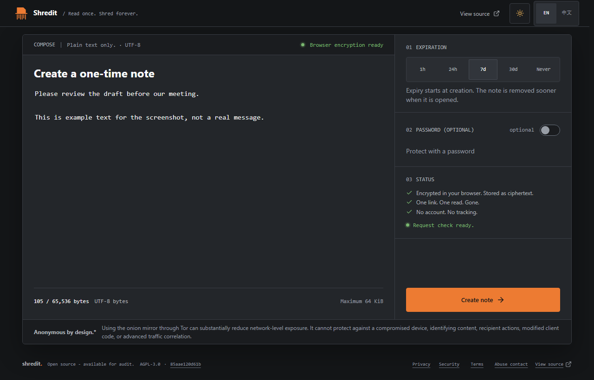

# Shredit

Read once. Shred forever.

Share a plain-text note through a link that can be opened once. Write your
message, choose its expiry, and send the link. No account required.

[Try Shredit](https://shredit.dev/) · [Self-host your own instance](docs/FORKING.md)
· [Privacy and limits](#privacy-and-limits)



The note editor on shredit.dev. The example text is synthetic and was not submitted.

## Send a note in three steps

1. **Write your message.** Choose an expiry and, optionally, require a password.
   The default expiry is seven days from creation.
2. **Create the note and share its link.** Your browser encrypts the text before
   upload. Copy the complete link; if you added a password, send it through a
   separate channel.
3. **The recipient explicitly opens the note.** The first successful open removes
   the stored note, so the link cannot deliver it again. Loading the page or
   generating a link preview does not open or delete it.

Anyone with the complete link and any required password can open the note,
including the sender. Do not open your own link to test it: a successful open
uses the one-time delivery. A recipient can still copy or photograph the text.

## What you can share

- Plain-text notes up to **64 KiB of UTF-8 text**. No files or attachments.
- Expiry after **one hour, 24 hours, seven days, 30 days, or never**. Expiry starts
  at creation; a successful open removes the note sooner, even with “never”.
- An optional password gate, in addition to possession of the complete link.
- English and Simplified Chinese interfaces, with light and dark themes.
- No accounts, trackers, advertising, or remote fonts. No editing or recovery.

## Privacy and limits

The browser encrypts each note with AES-256-GCM before upload. The decryption key
stays after `#` in the share URL (the fragment) and is not sent in HTTP requests.
The server stores encrypted content and enforces one-time delivery. Keep the
complete link private: it contains the key needed to read the message.

- The optional password controls server access; it is **not a second encryption
  key**. Share it separately from the link.
- A successful server-side open consumes the note before browser decryption.
  A damaged key, browser crash, or failed decryption can therefore make the note
  permanently unavailable. There is no recovery feature.
- This does not prevent screenshots, copied text, a compromised device, or a
  modified client from exposing content. It does not guarantee anonymity.
- Public source is available for review, **not a claim of an independent audit**.
  A branch name or footer commit link does not prove what code an instance runs.

Read the [threat model](THREAT_MODEL.md) for the full trust boundaries and risks.

## Project status and support

Shredit is an early release (`0.1.0`). You can use the
[public application](https://shredit.dev/), inspect the source, or run your own
instance. The upstream branch is `master`; security fixes target that branch and
the operator-selected current release, as described in the
[security policy](SECURITY.md).

For non-sensitive bugs and feature suggestions, use
[GitHub Issues](https://github.com/goyeroimi/shredit.dev/issues). Report code
vulnerabilities privately through the [security reporting process](SECURITY.md),
not a public issue. For an incident on a deployed instance, contact its operator
through that instance's security or abuse page. Never include note content,
passwords, or complete share links in a report.

## Local development

Requirements: Node.js 22, pnpm 10 (`10.12.4` is recorded in `package.json`), and
Docker Compose v2 for the supplied local PostgreSQL/Valkey services.

```sh
git clone --branch master --single-branch https://github.com/goyeroimi/shredit.dev.git
cd shredit.dev
pnpm install --frozen-lockfile
```

Copy `.env.example` to `.env.local` using your editor or file manager. It is a
local-only template, not a production configuration. Generate independent values
for `IP_HASH_SECRET`, `POW_SECRET`, and `IDEMPOTENCY_HMAC_SECRET` with the command
below, running it separately for each value, and paste them only into the ignored
`.env.local` file. Do not paste them into an issue or commit.

```sh
node -e "process.stdout.write(require('node:crypto').randomBytes(32).toString('base64url') + '\n')"
```

After saving the three independent values, start the local services and app:

```sh
docker compose -f docker-compose.local.yml up -d postgres valkey
pnpm run db:migrate
pnpm run db:reconcile-capacity
pnpm run dev
```

Open [http://127.0.0.1:3232](http://127.0.0.1:3232), matching the configured local
origin. Never point local migrations or tests at a production database. The
Compose password and template placeholders are disposable local fixtures only.

The application uses Next.js and React, PostgreSQL for note storage, and Valkey
for rate limiting. Turnstile and an onion origin are optional operator features;
see the [deployment guide](docs/DEPLOYMENT.md) before exposing an instance.

## Checks and contributions

```sh
pnpm run lint
pnpm run typecheck
pnpm test
pnpm run build
pnpm run repository:check
```

To contribute, fork the repository, work on a feature branch, and open a pull
request against `master`. Read [CONTRIBUTING.md](CONTRIBUTING.md) for the review
process, local Git safeguards, and documentation rules. Keep secrets out of
commits; security-sensitive protocol changes need regression tests.

## Documentation

- [Forking and self-hosting](docs/FORKING.md)
- [Deployment contract](docs/DEPLOYMENT.md)
- [Contributing](CONTRIBUTING.md)
- [Threat model](THREAT_MODEL.md)
- [Security reporting](SECURITY.md)
- [Protocol specification](SHREDIT_PROJECT_SPEC.md)
- [Implementation decisions](docs/IMPLEMENTATION_DECISIONS.md)

Repository documentation is in English. The application supports English and
Simplified Chinese. The protocol specification includes historical deployment
defaults; use the deployment guide for current repository, branch, and port
settings. Fork operators must supply their own configuration and contacts.

## License

[GNU AGPL v3 only](LICENSE). If you modify the application and make it available
to users over a network, provide those users access to the corresponding source
as required by the license. Preserve license and copyright notices.
